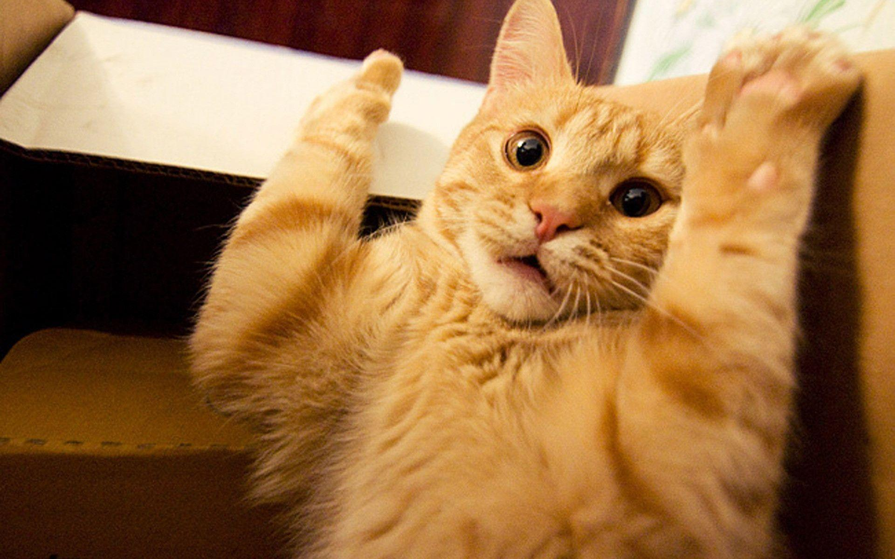
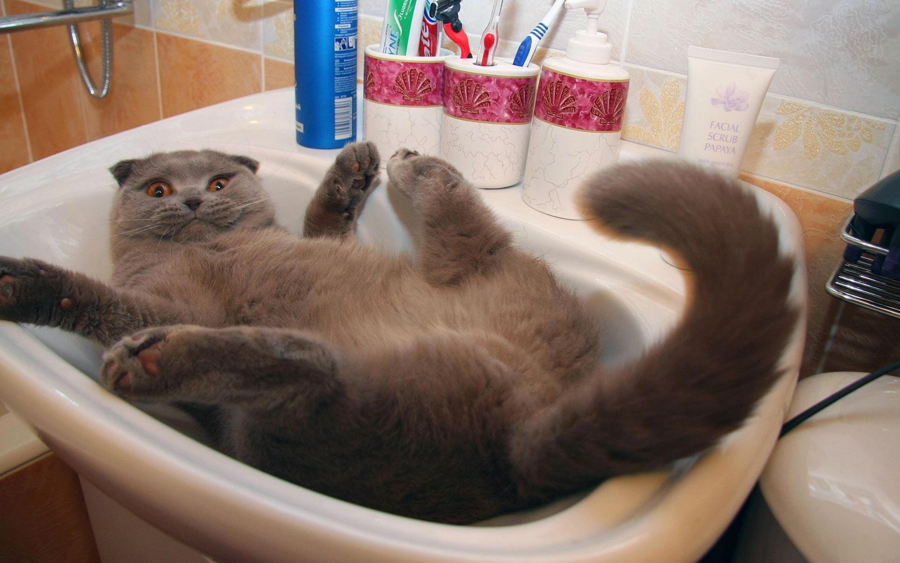
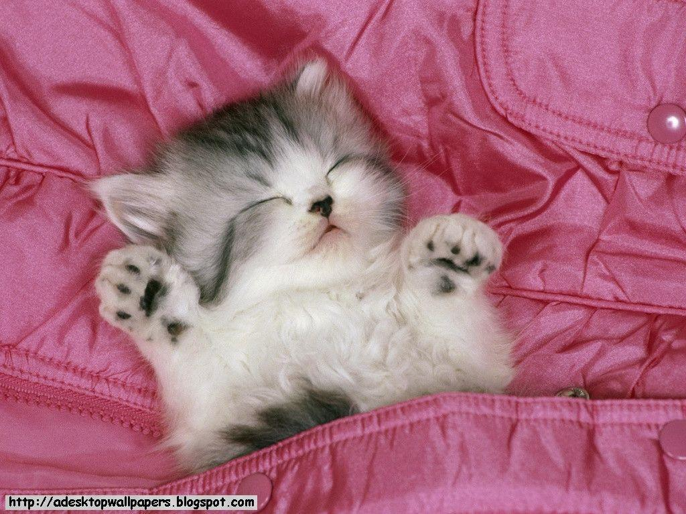

# 🐱 CatCB

### 🐾 A little tool that makes everyday work easier.

<p align="center">
  
</p>

Hi, and welcome to CatCB! 🐈

CatCB started as a small personal project. I wanted one place to keep the text snippets I use regularly, without having to search through old notes or type the same things over and over again.

As I kept working on it, I added features, adjusted the interface, fixed things that annoyed me, and slowly turned it into a tool that fits the way I like to work.

Now I'm sharing it here in case it can make someone else's day a little easier, too.

And yes, there are cats. Quite a few, actually. 🐈‍⬛

---

## 🐾 What can CatCB do?

CatCB is a Windows productivity tool for keeping reusable text organized and making everyday tasks a little less repetitive.

| Feature | What it does |
|---|---|
| 🐱 **Text snippets** | Save frequently used text in custom categories. |
| 🐾 **Multiple selection** | Select and manage several snippets at once. |
| ✂️ **Clipboard shortcuts** | Copy, cut, paste, and delete snippets efficiently. |
| ↩️ **Undo and redo** | Recover from changes while working. |
| 🗂️ **Custom organization** | Use categories and icons to keep things easy to find. |
| 📝 **Report Studio** | Prepare and edit report content in one place. |
| ✉️ **Outlook Studio** | Prepare email content and work with Outlook messages. |
| 💾 **Local storage** | Keep your snippets and settings on your Windows profile. |
| 🎨 **Personalization** | Adjust parts of the interface to suit your preferences. |

The idea isn't to replace every tool you already use. It's simply to make the repetitive parts of your day a little easier. 🐈

## 😻 A little look inside

Here's where your own CatCB screenshots can shine!

<p align="center">
  
</p>

<p align="center">
  <em>Keep your snippets organized. Find what you need. Get on with your day. 🐾</em>
</p>

If you add more screenshots later, you can put them in the `assets` folder and display them here.

## 🐈 Download CatCB

The easiest way to get started is to download the latest compiled Windows version.

<p align="center">
  <a href="https://github.com/bejlintkiraly/CatCB/releases/latest">
    <strong>🐾 Download the latest CatCB release</strong>
  </a>
</p>

1. Open the [Releases page](https://github.com/bejlintkiraly/CatCB/releases).
2. Download `CatCB.exe` from the latest release.
3. Save it somewhere convenient on your Windows PC.
4. Run the application.

You don't need to install Python or build anything from source to use the prebuilt release. 😸

<p align="center">
  
</p>

### 🛡️ Windows SmartScreen notice

Windows may display a SmartScreen warning when you launch CatCB. This can happen with independently published applications that don't yet have an established reputation or a trusted digital signature.

The warning alone doesn't mean the application is malicious, but it also shouldn't be treated as proof that a file is safe.

For your own peace of mind, download CatCB only from the official GitHub Releases page. If you're unsure about a file or don't trust its source, don't run it.

## 🖥️ What do I need?

- 🐈 A Windows PC.
- 🐾 The downloaded CatCB executable.
- ✉️ Microsoft Outlook Classic, installed and configured, for features that rely on its desktop integration.

The availability of some features may depend on your local Windows and Outlook setup.

## 🔧 Want to build it yourself?

The source code is available in this repository for people who want to inspect how the project is put together.

The project includes a Windows build script named `BUILD_TEST_EXE.bat`.

1. Install Python and make sure the required components are available.
2. Download the source code from this repository.
3. Extract the files into a folder.
4. Open that folder and run `BUILD_TEST_EXE.bat`.
5. If the build completes successfully, look for `CatCB.exe` inside the `dist` folder.

The exact requirements depend on the current build script and your local environment. If something doesn't work, check the error output first.

For everyday use, downloading the prebuilt release is the simpler option. 🐾

## 💾 Where is my data stored?

CatCB stores its application data locally under your Windows user profile:

```text
%APPDATA%\CatCB\state.json
```

Keeping the data separate from the executable means that replacing CatCB with a newer version normally doesn't require you to start from scratch.

Still, it's a good idea to keep a backup of this file before trying a new build or making major changes.

One small reminder: if you store sensitive information in your snippets, check your saved data before sharing it with anyone.

Your snippets are yours. Even the ones with suspiciously many cat references. 😹

<p align="center">
  
</p>

## 🔄 Updates

New versions and their changes are published on the GitHub Releases page.

- 🐾 [Latest release](https://github.com/bejlintkiraly/CatCB/releases/latest)
- 🐈 [All releases and changelogs](https://github.com/bejlintkiraly/CatCB/releases)

Before updating, close CatCB and back up your saved data if it contains anything important. Always download updates from the official repository.

## 💬 Found a bug or have an idea?

CatCB is an ongoing personal project, and feedback is welcome. 🐱

If something doesn't work as expected, or you have an idea that could make it more useful, feel free to open a GitHub issue.

I can't promise every suggestion will make it into the application, but useful feedback is always appreciated.

<p align="center">
  <a href="https://github.com/bejlintkiraly/CatCB/issues">
    <strong>🐾 Report a bug or suggest an improvement</strong>
  </a>
</p>

<p align="center">
  
</p>

## 📜 License and usage

Copyright (c) 2026 bejlintkiraly. All rights reserved.

This project is publicly available for viewing on GitHub, but no license is granted to use, copy, modify, or redistribute the source code. All rights are reserved unless explicit permission is granted by the copyright holder.

You may download and use the official prebuilt releases for personal use. Permission to use the application does not grant permission to redistribute the executable or publish modified versions.

No third-party rights are granted or changed by this notice.

## ⚠️ Disclaimer

CatCB is provided "as is", without warranties of any kind. Use it at your own discretion and keep backups of important data.

CatCB is an independent personal project. It is not affiliated with, endorsed by, or officially connected to Microsoft.

---

<p align="center">
  🐈‍⬛ <strong>Made with a lot of tweaking, a little stubbornness, and a cat-inspired touch.</strong> 🐈
  <br>
  <em>Thanks for stopping by. Hope CatCB makes your day a little easier! 🐾</em>
</p>
